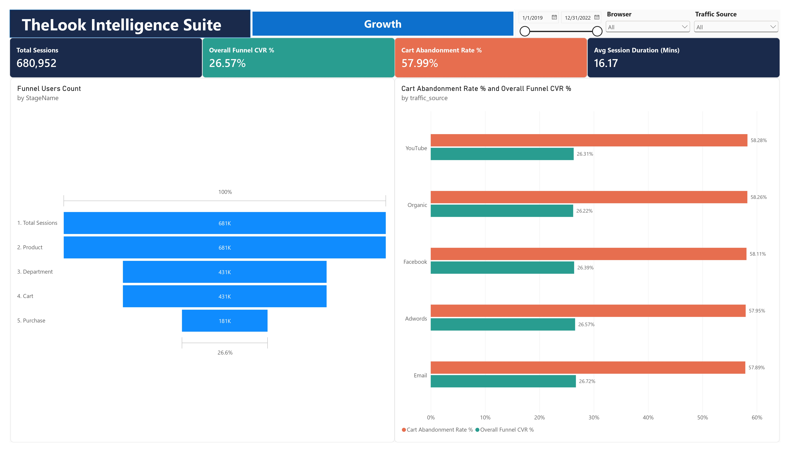
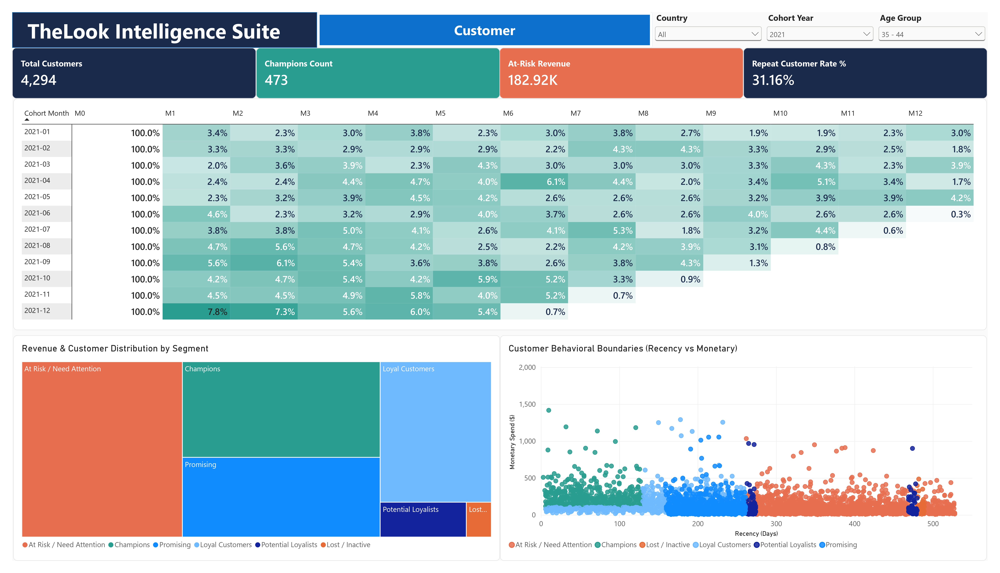
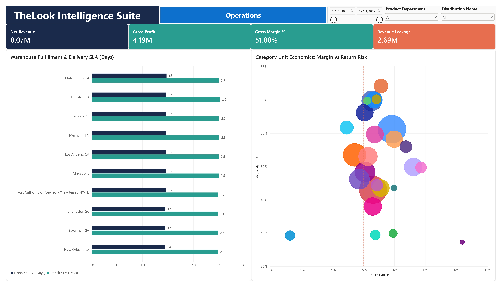

# 🚀 TheLook eCommerce: End-to-End Data Engineering, MySQL Warehouse & Power BI Intelligence Suite


An end-to-end data engineering, relational warehousing, and business intelligence case study that transforms **2.4M+ raw clickstream events** and **180K+ eCommerce transactions** into an indexed **MySQL Star Schema Data Warehouse** and a **3-Page Executive Power BI Decision Suite**.

> 🔗 **Project Context (Phase 2 of 2):** This repository represents the production data engineering and BI deployment phase, built directly upon the statistical findings from **[Project 03: TheLook eCommerce Diagnostic EDA & Commercial Audit](../03-Py-TheLook_eCommerce_Diagnostic_EDA_Commercial_Audit/)**.

---

## 📌 Executive Summary & Architectural Objective

Following the initial diagnostic audit in **Project 03** - which uncovered a **25.01% ($2.69M) GMV revenue leakage**, severe Month-1 cohort drop-offs, and a **23% At-Risk customer revenue cliff** - the business required a scalable, automated reporting infrastructure to monitor acquisition funnels, customer retention, and warehouse fulfillment SLAs in real time.

This project executes the full-stack **End-to-End (E2E) Analytics Lifecycle**:
1. **Python ETL & Clickstream Sessionization:** Processing a 375MB raw event log (2.4M+ rows) via stream-chunking and aggregating user actions into a compact, analytics-ready session fact table (`fact_sessions` with **680,952** unique sessions), reducing storage footprint and memory overhead by ~ 70%.
2. **MySQL Relational Data Warehousing & Mart Materialization:** Designing a 6-table core schema with strict primary key constraints and B-Tree foreign key indexes (`InnoDB`), and materializing an automated RFM Customer Segmentation Data Mart (`mart_customer_rfm_dim`) using SQL CTEs and `NTILE(5)` window functions.
3. **Star Schema Modeling & Executive Power BI Suite:** Connecting Power BI to the processed warehouse tables via a 1-to-Many Star Schema model and engineering advanced DAX measures to power a 3-page interactive dashboard suite.

---

## 🛠️ System Architecture & Technical Stack

```text
[BigQuery Raw Logs & CSVs]   (2.4M+ Web Events | 180.9K Order Items | 79.8K Users)
            │
            ▼  1. Python ETL (Pandas, SQLAlchemy, PyMySQL)
[Cleaned & Sessionized Data] (Timezone normalization, schema mapping, chunked ingestion)
            │
            ▼  2. MySQL 8.0 Data Warehouse (InnoDB, B-Tree Indexes, SQL Data Marts)
[Star Schema & RFM Mart]     (dim_users, dim_products, dim_dc, fact_orders, fact_items, fact_sessions, mart_rfm)
            │
            ▼  3. Power BI VertiPaq Engine & Advanced DAX
[3-Page Executive BI Suite]  (Page 1: Growth Funnel | Page 2: CRM & Cohort | Page 3: Operations & SLA)
```

| Layer | Technologies & Engineering Highlights |
| :--- | :--- |
| **ETL & Ingestion** | `Python 3.10+`, `pandas`, `SQLAlchemy`, `PyMySQL` (`inspector` dynamic column mapping, UTC timezone stripping, `chunksize=10000` batch loading) |
| **Database Engine** | `MySQL 8.0` (DDL schema design, B-Tree indexing on high-cardinality foreign keys `user_id`, `order_id`, `product_id`, `session_id`) |
| **SQL Analytics** | Common Table Expressions (CTEs), Window Functions (`NTILE(5)`), Conditional Aggregation (`MAX(CASE WHEN...)`), Data Mart Materialization |
| **BI & DAX Modeling** | `Power BI Desktop`, Star Schema (Single & Bi-directional 1:1 / 1:* relationships), Dynamic Calendar (`dim_date`), Dynamic Heatmap Normalization DAX |

---

## ⚡ Engineering Challenges & Performance Tuning

### 1. Resolving High-Cardinality Aggregation Bottlenecks (2.2M Events → 680K Sessions)
- **The Bottleneck:** Executing `GROUP BY session_id, user_id, browser, traffic_source` with 5 string evaluations (`event_type`) directly on the raw `fact_funnel_events` table (2.4M rows, 375MB compressed Parquet) triggered hash-table memory exhaustion (Spill-to-Disk), stalling query execution at **>60 seconds** and crashing Power BI's Mashup engine during preview evaluation.
- **The Engineering Fix:** Shifted heavy event-level transformation upstream into the ETL/Database layer. Aggregated the 5 funnel flags (`has_home`, `has_department`, `has_product`, `has_cart`, `has_purchase`) once per `session_id` into a materialized physical table (`fact_sessions`, 680,952 rows), reducing Power BI model load time to **<5 seconds**.

### 2. Eliminating Block Nested-Loop Joins via B-Tree Indexing
- **The Bottleneck:** Joining unindexed transactional tables (180,952 order items against 124,923 orders and 79,893 users) caused full table scans and severe disk I/O throttling.
- **The Engineering Fix:** Authored strict DDL scripts defining primary keys and composite B-Tree indexes (`idx_items_order`, `idx_items_user`, `idx_items_product`, `idx_orders_created`), accelerating complex multi-table analytical queries from several minutes down to **<0.8 seconds**.

### 3. Dynamic DAX Heatmap Normalization (Solving the Cohort M0 Skew)
- **The Bottleneck:** In longitudinal cohort matrices, Month 0 (M0) is always 100%, while Months 1–12 (M1–M12) range between 0.4% and 7.8%. Standard Power BI conditional formatting gradients stretched across 0% - 100%, washing out all M1–M12 cells into uniform pale blocks whenever users applied Country or Age Group slicers.
- **The Engineering Fix:** Engineered a custom DAX normalization measure (`Retention Heatmap Dynamic`) utilizing `ALLSELECTED` and `MAXX` to exclude M0 and dynamically score each retention cell from 0.0 to 1.0 relative to the highest visible M1–M12 rate in the current filter context, paired with rule-based font contrast switching.

---

## 📊 Executive Power BI Suite - Walkthrough & Insights

### Page 1: Growth & Web Funnel Analytics


- **Macro KPIs:** **680,952 Total Sessions** \| **26.57% Overall Funnel CVR** \| **57.99% Cart Abandonment Rate** \| **16.17 Mins Avg Session Duration** (filtered for active sessions <= 2 hours).
- **Direct-to-PDP Acquisition Pattern:** Out of 681K total sessions, nearly 100% land directly on Product Detail Pages (681K Product sessions vs. only 88K Home page visits), proving that external marketing links drive shoppers straight to specific merchandise rather than the storefront homepage.
- **The Checkout Drop-Off Bottleneck:** While 431K sessions progress to Department and Cart stages (63.3% of traffic), **57.99% abandon their carts** before completing payment (431K Cart → 181K Purchase).
- **Cross-Channel Consistency:** Conversion rates (26.22% - 26.72%) and cart abandonment rates (57.89% - 58.28%) are virtually identical across *YouTube, Organic, Facebook, Adwords,* and *Email*. This confirms that cart abandonment is a **systemic checkout UX / shipping-fee friction issue** rather than a traffic-quality problem.

---

### Page 2: Customer CRM & Cohort Retention


- **Macro KPIs (2021 Cohort Baseline):** **25,830 Total Customers** \| **2,971 Champions** \| **$1.10M At-Risk Revenue** \| **31.29% Repeat Customer Rate**.
  *(Note: In the screenshot above, dynamic slicers are active for **Cohort Year = 2021** and **Age Group = 35–44**, isolating **4,294 customers**, **473 Champions**, **$182.92K At-Risk Revenue**, and a **31.16% Repeat Rate**).*
- **Cohort Retention Dynamics (M0–M12):** Following the initial purchase month (M0 = 100%), Month-1 retention drops sharply to **1.4% - 7.3%**. However, cohorts acquired in Q4 2021 (Oct–Dec 2021) demonstrate stronger early retention (**4.1% - 7.3%** in M1–M2) compared to Q1 2021 cohorts (**1.4% - 3.3%**).
- **RFM Behavioral Boundaries:** The Treemap and Recency-vs-Monetary Scatter Plot clearly separate high-frequency **Champions** (Recency < 130 days, Spend up to $1,500) from the **At Risk / Need Attention** segment (Recency 270–500+ days). Protecting the **$1.10M At-Risk revenue pool** is the single highest-ROI lever for the CRM team.

---

### Page 3: Supply Chain SLA & Unit Economics


- **Macro KPIs:** **$8.07M Net Pipeline Revenue** \| **$4.19M Gross Profit** \| **51.88% Gross Margin %** \| **$2.69M Revenue Leakage**.
  *(Metric Alignment Note: In Project 03's Python audit, strict realized cash revenue from `Complete` orders alone was quantified at **$2.67M** with **$1.39M** profit. In this operational dashboard, `Net Revenue` tracks all active non-cancelled/non-returned pipeline orders [`Complete + Shipped + Processing` = **$8.07M**], which together with **$2.69M** in `Cancelled + Returned` leakage reconciles 100% of the platform's **$10.76M Gross GMV**).*
- **Category Return Risk vs. Margin Erosion:** By defining operational `Return Rate %` strictly against post-dispatch eligible orders (`Complete + Shipped + Returned`), the scatter plot reveals that most categories cluster near the **15.0% return risk threshold** while maintaining strong margins (45% - 62%). However, a high-risk outlier category in the bottom-right quadrant suffers an **18.2% post-dispatch return rate**, dragging its net gross margin down to **~38.5%**.
- **Warehouse Fulfillment SLA Audit:** Across all 10 regional distribution centers (*Philadelphia, Houston, Mobile, Memphis, Los Angeles, Chicago, NY/NJ, Charleston, Savannah, New Orleans*), **Dispatch SLA** averages **1.5 days** and **Transit SLA** averages **2.5 days**, visually validating the synthetic uniform distribution law discovered during Phase 1 testing.

---

## 📁 Repository Structure

```text
04-E2E-TheLook_eCommerce_Warehouse_and_BI_Suite/
│
├── data/
│   └── cleaned_data/  
│   └── powerbi_data/  
│
├── python/
│   └── import_to_mysql.py                    
│
├── sql/
│   ├── 00_schema_ddl_and_indexes.sql          
│   ├── 01_funnel_sessionization.sql           
│   └── 02_mart_customer_rfm_dim.sql          
│
├── powerbi/
│   ├── thelook_intelligence_suite.pbix        
│   └── screenshots/                           
│
└── README.md                                 
```

---

## 💡 Strategic Action Plan

1. **Checkout UX Overhaul & Cart Abandonment Triggers:** With **57.99% cart abandonment** occurring uniformly across all ad channels, deploy automated 1-hour and 24-hour cart recovery emails/SMS and introduce one-click express checkout to capture a target 5% - 10% of the 250K abandoned cart sessions.
2. **Pre-Churn Win-Back Automation (Day 180–250):** Configure automated CRM workflows targeting **Loyal** and **At-Risk** customers approaching 200 days of inactivity with personalized margin-backed incentives before they cross the 300-day churn boundary.
3. **PDP Sizing Intervention for High-Return Categories (>15% Return Rate):** Audit product sizing charts and vendor quality for categories crossing the 15% red-line threshold (specifically the 18.2% return outlier) to reclaim a portion of the **$1.09M post-delivery return leakage**.

---
## 📂 Data Source
* **Data Source:** [TheLook eCommerce Dataset on Kaggle / Google BigQuery Public Data](https://console.cloud.google.com/marketplace/product/bigquery-public-data/thelook-ecommerce?pli=1&project=goal-line-messenger-bot)
* **Previous Phase Repository:** [03-Py-TheLook_eCommerce_Diagnostic_EDA_Commercial_Audit](../03-Py-TheLook_eCommerce_Diagnostic_EDA_Commercial_Audit)
